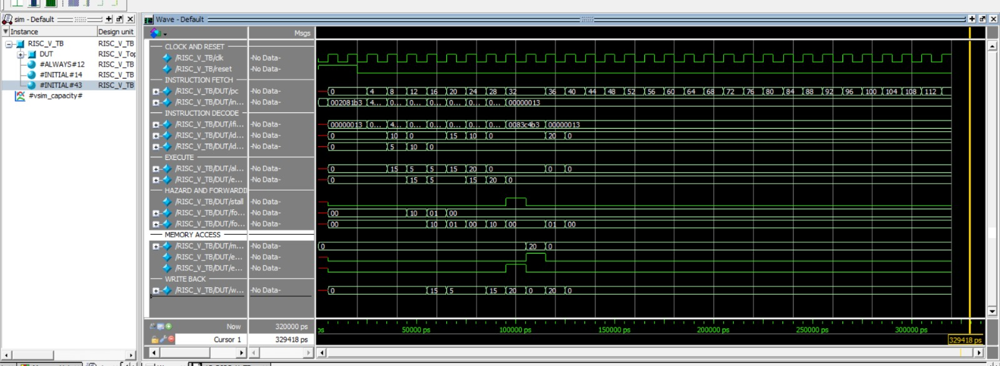

# 5-Stage-Pipelined-RISC-V-Processor
5-stage pipelined 32-bit RISC-V processor designed using Verilog HDL. Implements ALU, register file, forwarding, hazard detection, and load/store operations. Simulated and tested using ModelSim.

## About the Project

This project is an implementation of a 32-bit RISC-V processor using Verilog HDL. It follows a 5-stage pipelined architecture, where instruction execution is divided into Instruction Fetch, Instruction Decode, Execute, Memory Access and Write Back stages.

The project focuses on understanding processor pipelining, instruction execution, data dependencies and handling hazards using forwarding and hazard detection techniques.

## Pipeline Stages

| Stage | Description |
|---|---|
| IF | Fetches instructions from instruction memory |
| ID | Decodes instructions and reads register values |
| EX | Performs ALU operations and address calculations |
| MEM | Reads from or writes to data memory |
| WB | Writes the result back to the register file |

## Features

- 32-bit processor with a 5-stage pipeline.
- 32 general-purpose registers.
- Arithmetic and logical operations using an ALU.
- Instruction decoding and control signal generation.
- Data forwarding to handle dependencies between instructions.
- Hazard detection for load-use dependencies.
- Pipeline registers between all five stages.
- Load and store operations using data memory.
- Verilog testbench for functional simulation.

## Instructions Supported

| Instruction | Type | Operation |
|---|---|---|
| ADD | R-Type | Addition |
| SUB | R-Type | Subtraction |
| AND | R-Type | Bitwise AND |
| OR | R-Type | Bitwise OR |
| XOR | R-Type | Bitwise XOR |
| ADDI | I-Type | Addition with immediate |
| LW | I-Type | Load word |
| SW | S-Type | Store word |
| BEQ | B-Type | Branch if equal |

*Note: BEQ logic is implemented, but separate branch execution verification is still pending.*

## Main Modules

| Module | Function |
|---|---|
| Program Counter | Maintains the instruction address |
| Instruction Memory | Stores program instructions |
| Register File | Stores and provides register data |
| Control Unit | Generates control signals |
| Immediate Generator | Generates immediate values |
| ALU | Performs arithmetic and logical operations |
| Data Memory | Handles load and store operations |
| Pipeline Registers | Pass data between pipeline stages |
| Hazard Detection Unit | Detects load-use hazards |
| Forwarding Unit | Forwards data to handle dependencies |
| RISC-V Top | Connects all processor modules |

## Project Structure

```text
5-Stage-Pipelined-RISC-V-Processor/
│
├── RTL/
│   ├── 01_Program_Counter.v
│   ├── 02_Instruction_Memory.v
│   ├── 03_Register_File.v
│   ├── 04_Control_Unit.v
│   ├── 05_Immediate_Generator.v
│   ├── 06_ALU.v
│   ├── 07_Data_Memory.v
│   ├── 08_IF_ID_Register.v
│   ├── 09_ID_EX_Register.v
│   ├── 10_EX_MEM_Register.v
│   ├── 11_MEM_WB_Register.v
│   ├── 12_Hazard_Detection_Unit.v
│   ├── 13_Forwarding_Unit.v
│   └── 14_RISC_V_Top.v
│
├── Testbench/
│   └── 15_RISC_V_TB.v
│
├── Simulation/
│   └── RISC_V.do
│
├── Waveforms/
│   └── simulation.png
│
└── README.md
```

## Simulation Results

The design was compiled and simulated using ModelSim with a dedicated Verilog testbench.

The testbench initializes the registers with the following values:

- x1 = 10
- x2 = 5

The processor then executes arithmetic, logical and memory instructions.

### Instructions Executed

```assembly
ADD  x3, x1, x2
SUB  x4, x3, x1
AND  x5, x3, x4
OR   x6, x3, x4
ADDI x7, x1, 10
SW   x7, 0(x0)
LW   x8, 0(x0)
XOR  x9, x7, x8
```

### Final Register Values

| Register | Expected Value | Simulation Result |
|---|---:|---:|
| x3 | 15 | 15 |
| x4 | 5 | 5 |
| x5 | 5 | 5 |
| x6 | 15 | 15 |
| x7 | 20 | 20 |
| x8 | 20 | 20 |
| x9 | 0 | 0 |

### Data Memory

```text
Memory[0] = 20
```

All the above register and memory values matched the expected results in the simulation.

## ModelSim Waveform

The waveform helps to observe how the processor executes instructions and how the different pipeline stages interact.

It includes signals related to:

- Program counter and instruction fetching.
- ALU operations and results.
- Forwarding control signals.
- Hazard detection and pipeline stall.
- Memory read and write operations.
- Write-back data.

Add your actual ModelSim waveform screenshot here:



## How to Run

**Step 1: Open ModelSim**

Open ModelSim and navigate to the project directory.

**Step 2: Compile the RTL files**

```tcl
vlib work
vlog RTL/*.v
vlog Testbench/15_RISC_V_TB.v
```

**Step 3: Start the simulation**

```tcl
vsim -voptargs=+acc work.RISC_V_TB
```

**Step 4: Add signals to the waveform**

```tcl
add wave -r sim:/RISC_V_TB/*
```

**Step 5: Run the simulation**

```tcl
run -all
```

You can also use the `.do` script provided in the Simulation folder, after checking that its file paths match the project directory.

## Tools Used

- Verilog HDL
- ModelSim
- Digital Electronics
- Computer Architecture

## What I Learned

Through this project, I gained practical experience in writing modular Verilog code, designing pipeline registers, implementing ALU operations, handling data dependencies and debugging RTL designs using ModelSim waveforms.

---

**Project:** 5-Stage Pipelined 32-bit RISC-V Processor

**Language:** Verilog HDL

**Simulation Tool:** ModelSim
